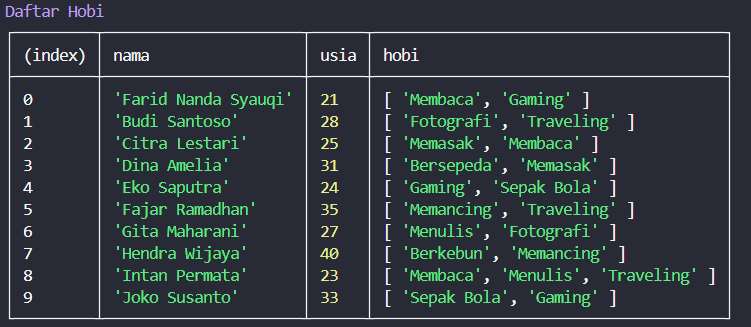
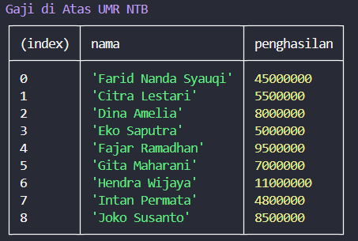
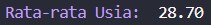
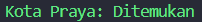
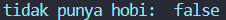
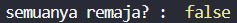

# Tugas 2 - Array Function

## Identitas
- Nama : Farid Nanda Syauqi
- NIM  : F1D02310050

## Deskripsi Tugas
Tugas ini bertujuan untuk memahami dan mengimplementasikan berbagai *higher-order array functions* pada JavaScript (seperti `map`, `filter`, `reduce`, `find`, `some`, dan `every`). Implementasi dilakukan menggunakan data array of objects (`dataClient`) untuk memanipulasi, menyaring, mengagregasi, dan mengecek kondisi data sesuai studi kasus yang ditentukan.

## Implementasi

### map()
- **Tujuan:** Membuat array baru yang berisikan objek dengan properti tertentu (`nama`, `usia`, dan `hobi`) dari `dataClient` untuk ditampilkan dalam bentuk tabel.
- **Screenshot:** 

### filter()
- **Tujuan:** Menyaring data klien yang memiliki penghasilan di atas UMR NTB (lebih dari Rp2.700.000) dan mengambil informasi `nama` serta `penghasilan`.
- **Screenshot:** 

### reduce()
- **Tujuan:** Menghitung total seluruh usia klien yang ada di `dataClient` untuk kemudian dicari nilai rata-rata usianya.
- **Screenshot:** 

### find()
- **Tujuan:** Mencari satu elemen/data klien pertama yang berdomisili di "Praya" berdasarkan properti `alamat.kota`.
- **Screenshot:** 

### some()
- **Tujuan:** Memeriksa apakah terdapat setidaknya satu klien di dalam array yang tidak memiliki hobi (panjang array `hobi` sama dengan 0).
- **Screenshot:** 

### every()
- **Tujuan:** Memeriksa apakah seluruh klien yang terdaftar berada dalam rentang usia remaja (10 hingga 19 tahun).
- **Screenshot:** 

## Kesimpulan
Penggunaan *higher-order array functions* di JavaScript sangat mempermudah pemrosesan data array tanpa perlu melakukan pengulangan manual (`for` / `while` loop):

1. **`map()`**: Digunakan untuk mentransformasi setiap elemen array menjadi bentuk/objek baru dengan ukuran array yang tetap sama.
2. **`filter()`**: Digunakan untuk menyaring elemen array berdasarkan kondisi tertentu, menghasilkan array baru yang ukurannya bisa lebih kecil dari array asal.
3. **`reduce()`**: Digunakan untuk mengagregasi atau mengumpulkan seluruh nilai elemen array menjadi satu nilai tunggal (misalnya total atau rata-rata).
4. **`find()`**: Digunakan untuk menemukan elemen **pertama** yang memenuhi syarat/kondisi pencarian.
5. **`some()`**: Menghasilkan nilai boolean (`true`/`false`), mengembalikan `true` jika **minimal ada satu** elemen yang memenuhi kondisi.
6. **`every()`**: Menghasilkan nilai boolean (`true`/`false`), mengembalikan `true` hanya jika **seluruh** elemen memenuhi kondisi yang ditentukan.